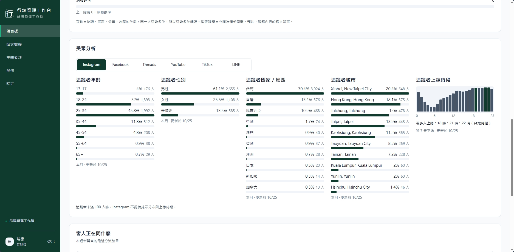
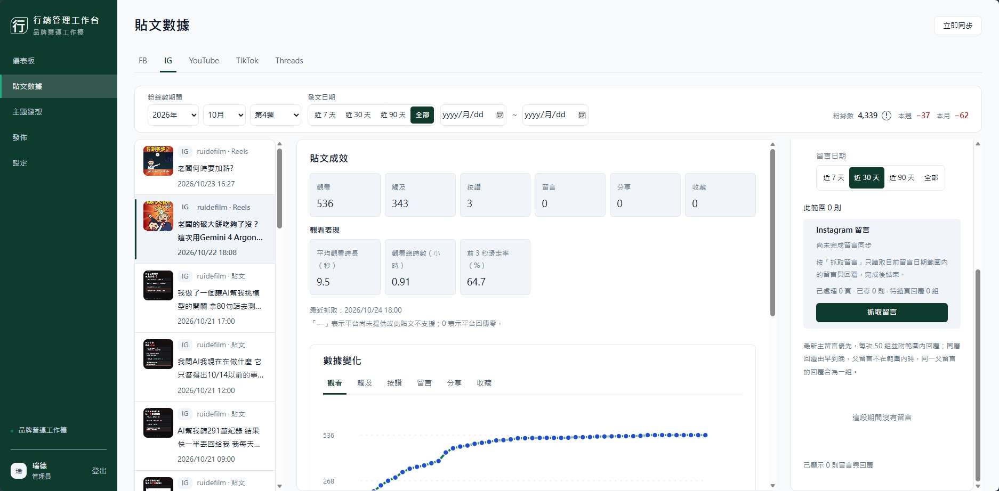
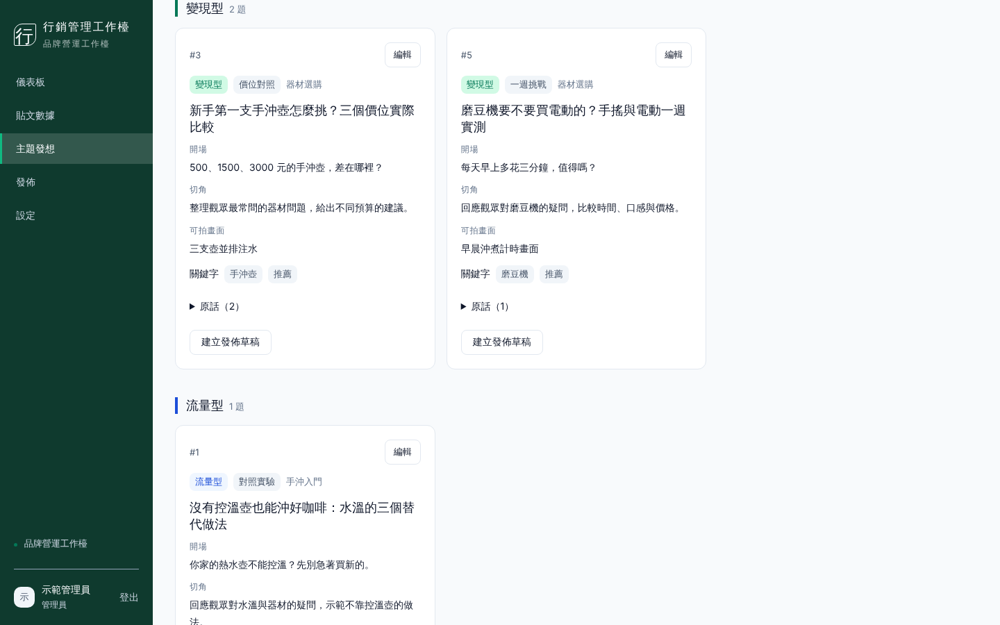

# 行銷管理工作檯（marketing-workbench）

給個人創作者或自有品牌自架的行銷工作檯：把 Facebook、Instagram、Threads、YouTube、TikTok 的貼文數據與觀眾留言集中管理，從留言整理內容主題，並在兩段式確認後發佈到多個平台。


<!-- TODO: 加上 CI 後補：[](https://github.com/<帳號>/<repo>/actions/workflows/ci.yml) -->
<!-- TODO: 發佈第一個 Release 後補：[](https://github.com/<帳號>/<repo>/releases) -->

**繁體中文** | [English](README_en.md) | [简体中文](README_zh-CN.md) | [日本語](README_ja.md)



| 貼文數據 | 主題發想 |
|---|---|
|  |  |

<sub>儀表板與貼文數據是作者自己的帳號 ruidefilm 的實際畫面；主題發想是虛構的範例。</sub>

## 功能特色

- 同步 Facebook、Instagram、Threads、YouTube、TikTok 的貼文成效；儀表板顯示趨勢、成長比較、轉換漏斗與受眾分析。
- 每小時抓取自家貼文留言；送給雲端模型前先遮蔽個資。
- 從選定貼文的留言整理證據，產生 15 個內容主題，附觀眾原話。
- 依主題撰寫腳本，檢查品牌禁語，可匯出。
- 排程或立即發佈到 FB／IG／Threads／YouTube，送出前兩段式確認；TikTok 只能送到 App 收件匣草稿。
- 內建 MCP 端點（Streamable HTTP），可接 Claude Code plugin、Claude 桌面版擴充與 Codex。
- 成員與角色權限（管理員／行銷人員／檢視者）、稽核紀錄、管理員一次性復原碼。
- 介面支援繁體中文、简体中文、English、日本語，支援 390px 手機寬度。
- 7-Zip 加密備份、LINE 通知（品牌通知群組與收訊健康警示）。

技術棧：Python 3.13、uv、FastAPI、SQLAlchemy 2、Alembic、SQLite（WAL）；前端 React 19、TypeScript、Vite。

## 自架前必讀

自架這個工作檯，你就是自己那組 Meta、Google、TikTok 應用程式的開發者，平台條款的義務在你身上。

- **只給自己或自有品牌使用**（單一品牌）。不要拿來代操客戶帳號或開放他人註冊，這需要各平台審核，TikTok 明確不接受。
- **帳號類型**：Facebook 需要粉絲專頁；Instagram 需要專業帳號並連結該粉專；Threads、YouTube、TikTok 用個人帳號即可。
- **隱私權政策與服務條款要自己寫**，放在自己的網站再填進各平台後台，範本在 [`docs/templates/`](docs/templates/)。
- **TikTok 只能送到收件匣草稿**，文案要在 TikTok App 內貼上。
- **Google 同意畫面要設成正式版**，否則 YouTube 授權每 7 天失效。
- **Gemini 只能用付費方案**；用個人方案的 AI 當 agent 時，關閉「用對話訓練模型」。

細節見 [`docs/合規須知.md`](docs/合規須知.md)，每條規定的官方出處見 [`docs/平台政策.md`](docs/平台政策.md)。

## 安裝步驟

需求：Windows（啟動與備份腳本是 PowerShell，macOS／Linux 尚未支援）、Python 3.13、[uv](https://docs.astral.sh/uv/)、Node.js、7-Zip、ngrok；建議另裝 Tailscale。

不熟指令的話，可以把 [`docs/agent安裝引導.md`](docs/agent安裝引導.md) 交給自己的 AI agent 逐步帶領安裝。

```powershell
# 1. 建立設定檔並填入 NGROK_AUTHTOKEN；資料路徑可留白（見下方「環境變數設定」）
copy .env.example .env

# 2. 後端：安裝依賴、產生加密主金鑰、建立資料庫
cd backend
uv sync
uv run python ../scripts/initialize_ai_encryption.py
uv run alembic upgrade head

# 3. 前端：建置
cd ../frontend
npm ci
npm run build

# 4. 啟動
cd ..
./scripts/start-all.ps1
```

`start-all.ps1` 只會替全新資料庫建立結構，不會升級既有資料庫；升級步驟見 [`docs/operations.md`](docs/operations.md)。

## 使用範例

第一次啟動時若 8000 已被其他程式佔用，`start-all.ps1` 會詢問要改用哪個連接埠並寫入 `.env`。

啟動後在執行工作檯的電腦開啟 http://127.0.0.1:8000（或你改用的連接埠），第一次會看到「首次設定」頁面，填入管理員帳號、密碼與品牌名稱後自動登入。之後到「設定」的平台連線卡片填入各平台應用程式的金鑰並按「連結〇〇帳號」。每張卡片的「設定教學」會列出要填到平台後台的回呼網址。

讓 Claude Code 連上工作檯（網址從「設定 → 我的帳號 → 安裝 Agent」複製）：

```text
/plugin marketplace add <內部網址>/plugin/marketplace.json
/plugin install mwb@marketing-workbench
```

安裝後可在 Claude Code 用 `/mwb:ideas` 接手主題發想。Codex 與 Claude 桌面版的安裝方式見 [`docs/operations.md`](docs/operations.md#agent-連線)。

<!-- TODO: 請補充一段從發想到發佈的完整操作示範（截圖或短片） -->

部署、更新、備份與排錯見 [`docs/operations.md`](docs/operations.md)；架構見 [`docs/architecture.md`](docs/architecture.md)。

開發時可以分開啟動：

```powershell
cd backend
uv run uvicorn app.main:app --host 127.0.0.1 --port 8000
cd ../frontend
npm run dev
```

## 環境變數設定

複製 `.env.example` 為 `.env`。後端的每個設定都有預設值，沒填的路徑會放在 repo 底下的 `data/`；完整清單與說明見 `.env.example` 的註解。

**啟動前一定要處理：**

| 變數 | 說明 |
|---|---|
| `NGROK_AUTHTOKEN` | `start-all.ps1` 啟動 Webhook 閘道時必填，沒有會直接停止。ngrok 執行檔要在 PATH，或用 `NGROK_PATH` 指定完整路徑 |
| `ACCOUNT_ENCRYPTION_KEY` | 在介面儲存平台金鑰或 AI 金鑰前必須有。在 `backend/` 執行 `uv run python ../scripts/initialize_ai_encryption.py` 自動寫入，並另外備份 `.env`；遺失後已加密的金鑰無法讀回 |

**第一次啟動會自動產生，不用手填：** `INGEST_API_KEY`、`WEBHOOK_PROBE_SECRET`、`WEBHOOK_PUBLIC_URL`（ngrok 指派的固定網址）。

**建議設定：**

| 變數 | 預設 | 說明 |
|---|---|---|
| `DATABASE_PATH` | `data/db/mwb.db` | 資料庫位置，建議用絕對路徑 |
| `EXPORT_ROOT` | `data/export` | 匯出檔目錄 |
| `LOG_PATH` | `data/logs/backend.jsonl` | 日誌檔 |
| `APP_ORIGIN` | `http://127.0.0.1:8000` | 允許的來源，可用逗號分隔多個。加入 HTTPS 網址（例如 Tailscale）時，`SESSION_COOKIE_SECURE` 必須設為 `true`，否則無法啟動 |
| `BACKEND_INTERNAL_URL` | `http://127.0.0.1:8000` | 後端監聽位址。改連接埠時 `APP_ORIGIN` 的本機網址要一起改，兩者埠號不同時 `start-all.ps1` 會拒絕啟動；它詢問連接埠時會兩個一起寫入 |
| `ALLOWED_HOSTS` | `["127.0.0.1","localhost"]` | 允許的主機名稱，必須逐一列出，不能用萬用字元 |
| `TAILSCALE_ENABLED` | `false` | 使用 Tailscale 時設 `true`，再執行 `node scripts/tailscale.mjs configure` 自動填好來源與主機 |
| `COMMENT_RETENTION_DAYS` | `365` | 他人留言保留天數（30–3650），每日排程刪除到期留言 |

**選用：**

| 變數 | 說明 |
|---|---|
| `GEMINI_API_KEY`／`OPENAI_API_KEY`／`ANTHROPIC_API_KEY` 與對應的 `*_MODEL` | 內建 AI 供應者；也可由管理員在介面驗證後加密儲存 |
| `GEMINI_PAID_TIER` | 預設 `false`；只有 Google Cloud 專案已綁定帳單時才設 `true`，否則 Gemini 不會處理平台資料 |
| `AI_MONTHLY_BUDGET_USD` | AI API 每月預算上限 |
| `NOTIFY_LINE_*` | LINE 通知用的 Messaging API 憑證與群組 |
| `BACKUP_LOCAL_ROOT`／`BACKUP_DRIVE_ROOT`／`BACKUP_PASSWORD`／`SEVEN_ZIP_PATH` | 加密備份位置、密碼與 7-Zip 路徑 |

各平台（Meta、Threads、YouTube、TikTok）的應用程式金鑰建議在介面的平台連線卡片填寫，會加密存入資料庫；權杖由連結流程寫入，不需要手動填。金鑰、權杖、密碼不要提交到 git。

## 貢獻指南

- 送 PR 前請在 `backend/` 跑 `uv run pytest`，並在根目錄跑 `npm --prefix frontend test`、`npm --prefix frontend run build`、`node --test scripts/*.test.mjs`。完整驗收是 `python scripts/verify_all.py`（需要 Chromium）。
- 測試一律使用隔離資料與 HTTP 替身，不可呼叫真實平台 API。
- 資料表變更一律透過 Alembic migration。
- 新增介面文字用 `t('繁中原文')` 包起來，並補 `frontend/src/locales/` 的英文、簡中、日文翻譯，用詞依 [`docs/i18n術語表.md`](docs/i18n術語表.md)。
- 平台串接只用官方 API，不接受爬蟲、非官方 API 或瀏覽器自動化。
- 架構與規則見 [`docs/architecture.md`](docs/architecture.md)、[`docs/MCP規範.md`](docs/MCP規範.md)、[`docs/UI規格.md`](docs/UI規格.md)。

歡迎送 PR。較大的改動（新平台、資料表變更、權限規則）請先開 issue 討論方向。回覆時間不固定，請多包涵。

問題或合作請寄 support@ruidefilm.com。安全性問題請直接寄信，不要開公開 issue。

## 授權

MIT License，見 [`LICENSE`](LICENSE)。使用本專案仍須遵守各平台條款，見 [`docs/合規須知.md`](docs/合規須知.md)。

## 致謝

這個專案建立在許多開源專案之上，特別感謝 [FastAPI](https://fastapi.tiangolo.com/)、[SQLAlchemy](https://www.sqlalchemy.org/)、[Alembic](https://alembic.sqlalchemy.org/)、[React](https://react.dev/)、[Vite](https://vite.dev/)、[uv](https://docs.astral.sh/uv/)、[Playwright](https://playwright.dev/) 與 [Model Context Protocol](https://modelcontextprotocol.io/)。

<!-- TODO: 如果要提到協助開發的人或 AI 工具，加在這裡 -->
